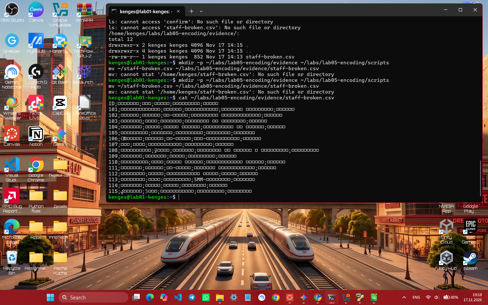

# Lab 5 — Encoding forensics

Name: Daler Kenges · Date: 17.11.2026 · Tools: Ubuntu guest controlled via PowerShell

## What I received

Excel: Misread the file as Windows-1252 (or merged columns if semicolon wasn't recognized), turning Cyrillic/Kazakh names into garbled Latin mojibake (e.g., Ð... / accented characters) instead of readable text.

LibreOffice: Import dialog defaulted to - Automatic - (Cyrillic (Windows-1251)) with ; separator; Russian text rendered, but Kazakh-specific letters broke (e.g., Әбдірахманова appeared as Jбдірахманова).

Powershell(cat): Expected UTF-8, so single-byte legacy Cyrillic/Kazakh characters rendered as replacement boxes (□) and stray diacritics (Ƣ, ÿ, Ƽ).

## Diagnosis (made before the fix)
- file said: Non-ISO extended-ASCII text, with CRLF line terminators (evidence/file-before.txt)
- First 16 bytes: 49 44 3b d4 e0 ec e8 eb e8 ff 3b c8 ec ff 3b ce (evidence/hexdump-before.txt)
- Encoding: KZ-1048 (RK1048 in iconv) — because Cyrillic and Kazakh characters are encoded as single bytes ("А" = c0, "я" = ff), and Kazakh-specific characters use KZ-1048 code points ("Ә" = a3 in "Әбдірахманова" at offset 0x2a, "і" = b3) rather than Windows-1251 (where 0xa3 is "Ј").
- Line ending: CRLF — because line 1 ends with the two bytes 0d 0a (\r\n) at offsets 0x24–0x25 right after "Город" and before "101".
- BOM: no — because the file begins directly with 49 44 ("ID") rather than EF BB BF, FF FE, or FE FF.
- Separator: ; (semicolon) — visible as byte 3b between column headers (ID;Фамилия;Имя;Отдел;Должность;Город).

## Fix
## Reasoning behind choices
- BOM: no — because the original file starts directly with 49 44 ("ID") rather than a byte order mark. In the fixed file I added a UTF-8 BOM (EF BB BF) so Microsoft Excel on Windows automatically detects UTF-8 upon double-clicking instead of falling back to the system legacy code page, while LibreOffice Calc and Linux terminal tools still parse the file cleanly.
- Line ending: CRLF — because line 1 ends with 0d 0a (\r\n). In the fixed file I converted line endings to LF (0a) so the file works reliably with Unix/Linux tools and shell scripts without trailing \r (^M) errors, while modern Excel and LibreOffice Calc still read LF-delimited rows properly.
<the command or scripts/fix.sh, in a code block>
## Fixing script

## Verification
<file-after.txt summary; the screenshot evidence/opens-correctly.png>

## What did not work the first time
<at least one real thing>
