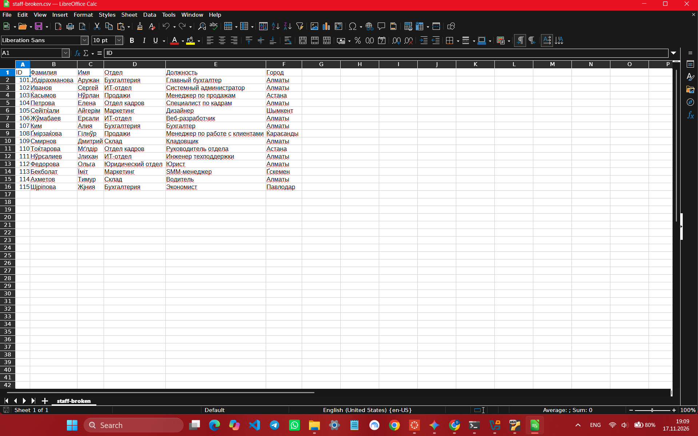

# Lab 5 — Encoding forensics

Name: Daler Kenges · Date: 17.11.2026 · Tools: Ubuntu guest controlled via PowerShell
```
Note: Although some screenshots related to the Ubuntu guest are labeled as PowerShell, those are the output of the Ubuntu guest, copy-paste operations with which went inside PowerShell, which I used to access Ubuntu with SSH command "ssh -p 2222 kenges@127.0.0.1", because setting copy-paste inside Ubuntu VM rendered significant amount of obstructions that would eventually force me to write everything manually. I tried Bi-directional Clipboard and inserting guest additions, but PowerShell offered significantly more comfort with copy-pasting for less frictions, which is the main reason I prefer this method. However, the Ubuntu VM was still running to make the whole procedure work
```
## What I received

Excel: Misread the file as Windows-1252 (or merged columns if semicolon wasn't recognized), turning Cyrillic/Kazakh names into garbled Latin mojibake instead of readable text.


LibreOffice: Import dialog defaulted to `- Automatic -` (`Cyrillic (Windows-1251)`) with `;` separator; Russian text rendered, but Kazakh-specific letters broke (e.g., `Әбдірахманова` appeared as `Jбдірахманова`).


PowerShell (`cat`): Expected UTF-8, so single-byte legacy Cyrillic/Kazakh characters rendered as replacement boxes (`□`) and stray characters.

## Diagnosis (made before the fix)
- **file said:** `Non-ISO extended-ASCII text, with CRLF line terminators` (`evidence/file-before.txt`)
- **First 16 bytes:** `49 44 3b d4 e0 ec e8 eb e8 ff 3b c8 ec ff 3b ce` (`evidence/hexdump-before.txt`)
- **Encoding:** `KZ-1048` (`RK1048` in `iconv`) — because Cyrillic and Kazakh characters are encoded as single bytes (`"А"` = `c0`, `"я"` = `ff`), and Kazakh-specific characters use KZ-1048 code points (`"Ә"` = `a3` in `"Әбдірахманова"` at offset `0x2a`, `"і"` = `b3`) rather than Windows-1251 (where `0xa3` is `"Ј"`).
- **Line ending:** `CRLF` — because line 1 ends with the two bytes `0d 0a` (`\r\n`) at offsets `0x24`–`0x25` immediately after `"Город"` and before `"101"`.
- **BOM:** `no` — because the file begins directly with `49 44` (`"ID"`) rather than `EF BB BF`, `FF FE`, or `FE FF`.
- **Separator:** `;` (semicolon) — visible as byte `3b` between column headers (`ID;Фамилия;Имя;Отдел;Должность;Город`).

## Fix

### Reasoning behind choices
- **UTF-8 with BOM (`EF BB BF`):** In the fixed file I added a UTF-8 BOM (`EF BB BF`) so Microsoft Excel on Windows automatically detects UTF-8 upon double-clicking instead of falling back to the system legacy code page, while LibreOffice Calc and Linux terminal tools still parse the file cleanly.
- **Line endings (`LF` / `0A`):** In the fixed file I converted `CRLF` (`0d 0a`) line endings to `LF` (`0a`) so the file works reliably with Unix/Linux tools and shell scripts without trailing `\r` (`^M`) errors, while modern Excel and LibreOffice Calc still read `LF`-delimited rows properly.

### Fixing script (`scripts/fix.sh`)
```sh
#!/bin/sh
# Lab 5: convert staff-broken.csv from RK1048 (KZ-1048) to UTF-8 with BOM and LF line endings
in=evidence/staff-broken.csv
out=evidence/staff-fixed.csv

iconv -f RK1048 -t UTF-8 "$in" > "$out"
sed -i 's/\r$//' "$out"
printf '\357\273\277' | cat - "$out" > tmp && mv tmp "$out"
```

## Verification
evidence/file-after.txt: file reports Unicode text, UTF-8 (with BOM) text (with no CRLF mention, confirming LF line endings), and xxd confirms the file starts with ef bb bf 49 44 3b (UTF-8 BOM + ID;) followed by two-byte d0/d1 UTF-8 Cyrillic sequences.

evidence/opens-correctly.png: Confirms staff-fixed.csv displays all Russian and Kazakh names (Әбдірахманова, Қасымов, Нұрлан) accurately and cleanly split into columns across Linux cat, Microsoft Excel (by double-click), and LibreOffice Calc.

## What did not work the first time
Testing WINDOWS-1251 before RK1048: Running iconv -f WINDOWS-1251 -t UTF-8 decoded Russian names properly but corrupted Kazakh letters (turning Әбдірахманова into Јбдірахманова, Қасымов into Ќасымов, and Нұрлан into Нўрлан). Checking the raw hex bytes (0xa3 for Ә) and switching the source encoding to RK1048 (KZ-1048) resolved every character cleanly.

## Artifacts & Evidence Index

### Data & Scripts
- **Original broken CSV:** [`evidence/staff-broken.csv`](evidence/staff-broken.csv)
- **Fixed UTF-8 CSV (with BOM & LF):** [`evidence/staff-fixed.csv`](evidence/staff-fixed.csv)
- **Conversion script:** [`scripts/fix.sh`](scripts/fix.sh)

### Forensic Logs
- **Pre-fix `file` output:** [`evidence/file-before.txt`](evidence/file-before.txt)
- **Pre-fix hex dump (`xxd`):** [`evidence/hexdump-before.txt`](evidence/hexdump-before.txt)
- **Post-fix `file` & hex verification:** [`evidence/file-after.txt`](evidence/file-after.txt)

### Visual Verification
- **Before — Microsoft Excel:** [`evidence/before-excel.png`](evidence/before-excel.png)
- **Before — LibreOffice Calc:** [`evidence/before-libreoffice.png`](evidence/before-libreoffice.png)
- **Before — PowerShell (`cat`):** [`evidence/before-powershell.png`](evidence/before-powershell.png)
- **After — Side-by-side verification (Ubuntu terminal, Excel & LibreOffice Calc):** [`evidence/opens-correctly.png`](evidence/opens-correctly.png)

---
## AI Usage
- **Tool:** Google Gemini
- **How it was used:**
  - Guided environment setup and repository organization (`git clone`, directory structuring, and pushing local Ubuntu artifacts to GitHub).
  - Helped interpret the `file` output and `xxd` hexadecimal byte offsets (`49 44`, `0d 0a`, `a3`, `b3`, and `ef bb bf`) to confirm `KZ-1048` (`RK1048`) encoding, `CRLF` line endings, and missing BOM.
  - Assisted in writing and verifying the POSIX shell conversion script (`scripts/fix.sh`) using `iconv`, `sed`, and `printf`.
  - Helped structure and refine the final `README.md` documentation and evidence index.
- **Verification:** Every command, byte offset, and converted CSV output (`staff-fixed.csv`) was executed and verified directly by me in Ubuntu, PowerShell, Microsoft Excel, and LibreOffice Calc.
