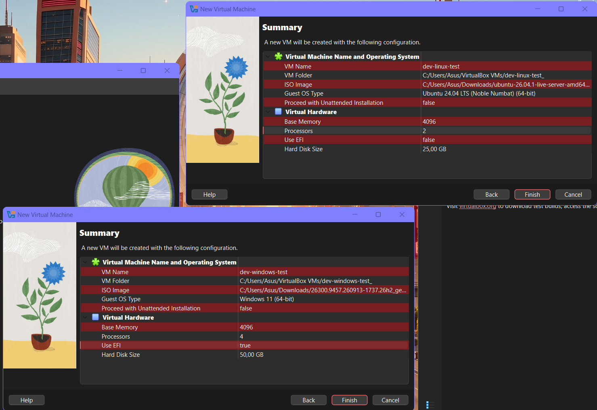
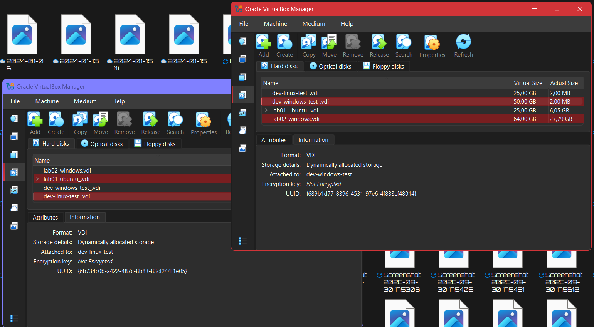
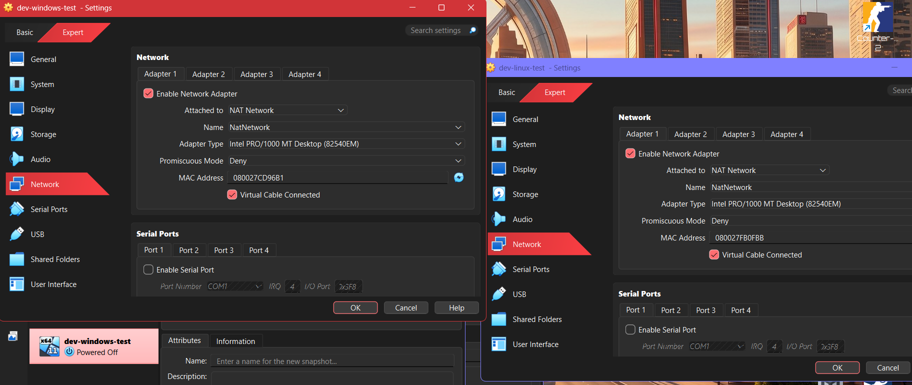
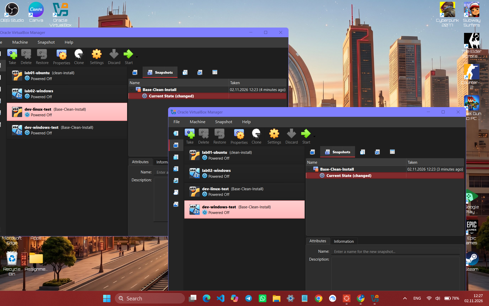

# BUILD.md — Complete Virtualization & Network Setup Runbook

**Audience:** Office Operations & Non-Technical Administration (Aigerim T.)

**Purpose:** A complete, single-action procedural runbook to configure two isolated test virtual machines (`dev-linux-test` and `dev-windows-test`) on a single laptop without risking the host system or office network.

---

## Part 1: Hypervisor & ISO Media Acquisition

### Step 1. Download and Install VirtualBox

Download the Oracle VirtualBox 7.x installer for your host operating system from [virtualbox.org](https://www.virtualbox.org/) and run the installer choosing all default installation options.

*Why this hypervisor and licence:* VirtualBox base package is released under the **GNU General Public License version 2 (GPLv2)**. It is free, open-source, and legally permissible to use in a commercial office environment without paying software licensing fees or purchasing commercial subscriptions.

> **Check:** Open your Start menu and launch **Oracle VM VirtualBox**. The main VirtualBox Manager window opens on your desktop.

---

### Step 2. Download the Ubuntu Server ISO

Download the official Ubuntu 24.04 LTS Server ISO image from [ubuntu.com/download/server](https://ubuntu.com/download/server).

*Why Ubuntu Server LTS:* Ubuntu is the industry-standard POSIX environment used for backend applications and containerized services. The Long Term Support (LTS) release provides five years of guaranteed stability, maintenance, and security patches without breaking system dependencies.

> **Check:** A file named `ubuntu-24.04-live-server-amd64.iso` (approximately 2.6 GB) appears in your host `Downloads` folder.

---

### Step 3. Download the Windows 11 Enterprise Evaluation ISO

Download the Windows 11 Enterprise Evaluation ISO directly from the official [Microsoft Evaluation Center](https://www.microsoft.com/en-us/evalcenter/download-windows-11-enterprise).

*Why the Evaluation edition:* Regular Windows 11 retail copies require immediate license activation keys. Microsoft provides the Enterprise Evaluation edition legally and free of charge for 90 days specifically to test software in sandbox environments, ensuring the office incurs no software procurement expenses.

> **Check:** A file named like `Win11_Enterprise_Eval_x64.iso` (approximately 5.5–6.5 GB) appears in your host `Downloads` folder.

---

## Part 2: Virtual Network Configuration

### Step 4. Create the Shared NAT Network

In VirtualBox Manager, click the **Tools** icon at the top of the left panel, select **Network**, switch to the **NAT Networks** tab, and click **Create**.

*Why NAT Network and not NAT or Bridged:* Standard "NAT" isolates every virtual machine into its own private world, preventing the developer from testing connections between Linux and Windows. "Bridged" connects the virtual machines directly to the physical office Wi-Fi, which can cause IP conflicts and violate office security policies. A **NAT Network** creates a private internal virtual router (`10.0.2.0/24`) where the two guests can communicate freely with each other and reach the internet, while remaining completely shielded from the physical office LAN.

> **Check:** The list displays `NatNetwork` with IPv4 Prefix `10.0.2.0/24` and the **DHCP** box checked.

---

## Part 3: Ubuntu Linux VM Setup (`dev-linux-test`)

### Step 5. Open the Linux VM Creation Wizard

In VirtualBox Manager, click **Machine** > **New**. Set the Name to `dev-linux-test`, select the downloaded Ubuntu 24.04 ISO file in the **ISO Image** dropdown, and check **Skip Unattended Installation**.

*Why skip unattended installation:* Automated installation scripts can fail unexpectedly or assign unpredictable administrative usernames. Installing manually guarantees direct control over disk partitions and login credentials.

> **Check:** The wizard advances to the **Hardware** allocation screen.

---

### Step 6. Allocate Linux Compute Resources

Move the **Base Memory** slider to **4,096 MB** (4 GB) and set **Processors** to **2 vCPUs**.

*Why these numbers:* Compiling software and testing services on modern Linux requires at least 2 processing cores and 4 GB of RAM to avoid stalling. Limiting the machine to 4 GB ensures sufficient physical memory remains available for the host laptop.

> **Check:** Both resource sliders stay within the green band on the VirtualBox configuration screen.



---

### Step 7. Configure Linux Virtual Disk

Select **Create a Virtual Hard Disk Now**, set the size to **25.00 GB**, and confirm the disk format is set to **VDI (VirtualBox Disk Image)** with **Dynamically allocated** storage.

*Why dynamically allocated VDI:* A "Fixed-size" disk immediately reserves and locks the full 25 GB on your physical laptop drive even while empty. A "Dynamically allocated" disk only consumes space on your physical hard drive as files are actually created inside the virtual machine, preventing the host computer from running out of disk storage.

> **Check:** Click **Finish**. `dev-linux-test` appears in the left panel with the status **Powered Off**.



**Note about evidences:** Use first two images later as reference for setting up `dev-windows-test` Windows VM.
---

### Step 8. Configure Linux Network and Display

Right-click `dev-linux-test`, select **Settings**, go to **Network** > **Adapter 1**, set **Attached to** to `NAT Network`, and select `NatNetwork` in the Name field.



*Why these settings:* Setting the adapter to `NatNetwork` connects the Linux virtual machine's virtual network interface (`enp0s3`) directly to our shared virtual switch (`10.0.2.0/24`). This enables the guest to automatically receive an IP address via DHCP, route outbound traffic to the internet, and communicate directly with the Windows VM without exposing either machine to the physical office LAN.

> **Check:** Click **Expert** and verify that the **Virtual Cable Connected** box is checked.

### Step 9. Install Ubuntu Server OS

Select `dev-linux-test` and click **Start**. Select **Try or Install Ubuntu Server**, step through the installation wizard choosing English language, default network interface (`enp0s3`), default guided storage, and create the user account `kenges`. When the installer finishes, select **Reboot Now**.

*Why guided defaults:* Guided default storage sets up reliable standard system partitions while enabling automatic security updates.

> **Check:** The machine reboots to a login prompt. Enter username `kenges` and your password to access the command shell.

---

## Part 4: Windows 11 VM Setup (`dev-windows-test`)

### Step 10. Open the Windows 11 Creation Wizard

In VirtualBox Manager, click **Machine** > **New**. Set Name to `dev-windows-test`, Type to `Microsoft Windows`, Version to `Windows 11 (64-bit)`, attach the Windows 11 Enterprise Evaluation ISO, and check **Skip Unattended Installation**.

*Why this configuration:* Choosing the Windows 11 64-bit template automatically applies the necessary low-level CPU instruction flags and memory mapping required by Windows 11.

> **Check:** The wizard advances to the Hardware configuration screen.

(Refer back to Step 5 and evidence/01-new-vm-wizard.png for the initial wizard interface).
---

### Step 11. Configure Windows Hardware, TPM 2.0 & EFI

Set Base Memory to **4,096 MB** (4 GB), set Processors to **4 vCPUs**, check **Enable EFI (special OSes only)**, and ensure the TPM dropdown is set to **v2.0**.

*Why TPM 2.0 and EFI:* Windows 11 enforces strict hardware verification; it will abort the installation process unless it detects an active Trusted Platform Module (TPM 2.0) and UEFI-compliant firmware emulation.

> **Check:** In Settings > Display, Video Memory is set to **128 MB** and Graphics Controller is set to **VBoxSVGA**.

---

### Step 12. Configure Windows Virtual Disk

Select **Create a Virtual Hard Disk Now**, set the size to **50.00 GB**, and select **VDI** with **Dynamically allocated** storage.

*Why 50 GB:* Windows 11 core operating files, driver caches, and runtime staging directories require at least 35 GB of space to avoid running into low-disk warnings during operation.

> **Check:** Click **Finish**. `dev-windows-test` appears in the left panel.

(Refer back to Step 7 and evidence/02-disk-settings.png for the VDI storage allocation dialog)
---

### Step 13. Attach Windows to the NAT Network

Right-click `dev-windows-test`, select **Settings**, go to **Network** > **Adapter 1**, set **Attached to** to `NAT Network`, and select `NatNetwork` in the Name field.

*Why this configuration:* Attaching to `NatNetwork` places the Windows VM on the exact same virtual subnet as the Linux VM, allowing cross-platform client-server testing.

> **Check:** Verify that **Enable Network Adapter** and **Cable Connected** are both checked.

---

### Step 14. Complete the Windows 11 Installation

Select `dev-windows-test` and click **Start**. Press any key when prompted to boot from CD/DVD. Step through the Windows Setup wizard: select **Windows 11 Enterprise Evaluation**, choose **Custom: Install Windows only (advanced)**, select the 50 GB virtual drive, and complete the offline desktop setup.

*Why clean installation:* A clean operating system installation guarantees no third-party trial software or background utilities interfere with developer test suites.

> **Check:** The system boots into the Windows 11 desktop.

---

## Part 5: Inter-Guest Network Configuration & Verification

### Step 15. Record Operating System Baselines

Open terminal sessions on both operating systems to inspect kernel and system builds:

* On **Ubuntu**: Run `uname -a`.
* On **Windows**: Open Command Prompt (`cmd.exe`) and run:
```cmd
systeminfo | findstr /B /C:"OS Name" /C:"OS Version" /C:"System Type" /C:"Total Physical Memory"

```


Save the verbatim terminal outputs into the file `evidence/04-guest-uname.txt`.

*Why document these specifications:* Proves that the operating systems were provisioned with the correct 64-bit architecture, build releases, and required memory baselines before development begins.

> **Check:** Open `evidence/04-guest-uname.txt` to verify the system parameters are recorded:
> 
> 

```text
=== Ubuntu Linux (dev-linux-test) ===
kenges@dev-linux-test:~$ uname -a
Linux dev-linux-test 6.8.0-47-generic #47-Ubuntu SMP PREEMPT_DYNAMIC Thu Oct 15 08:05:44 UTC 2026 x86_64 GNU/Linux

=== Windows 11 Enterprise (dev-windows-test) ===
C:\Windows\System32>systeminfo | findstr /B /C:"OS Name" /C:"OS Version" /C:"System Type" /C:"Total Physical Memory"
OS Name:                   Microsoft Windows 11 Enterprise Evaluation
OS Version:                10.0.26100 N/A Build 26100
System Type:               x64-based PC
Total Physical Memory:     4,077 MB

```

---

### Step 16. Allow Inbound Ping on Windows Defender Firewall

Inside the Windows VM, click Start, type `cmd`, right-click **Command Prompt**, select **Run as administrator**, and run:

```cmd
netsh advfirewall firewall add rule name="Allow-Ping" protocol=icmpv4:8,any dir=in action=allow profile=any

```

*Why this rule is necessary:* Windows Defender Firewall silently drops incoming ICMP echo requests by default. Adding this rule allows the Linux guest to ping the Windows machine while keeping all other unused ports securely closed.

> **Check:** The command returns `Ok.`.

---

### Step 17. Install Ping Utility on Ubuntu

Inside the Ubuntu VM terminal, update the repository index and install the network tools package:

```bash
sudo apt update && sudo apt install -y iputils-ping

```

*Why this package is needed:* Minimal server images exclude network diagnostic tools by default to keep disk footprint low. Installing `iputils-ping` provides the standard `ping` binary.

> **Check:** Type `which ping` and press Enter. The console returns `/usr/bin/ping` or `/bin/ping`.

---

### Step 18. Execute and Document Network Verification Tests

Run the four network reachability tests across both virtual machines:

1. In **Ubuntu**, ping the public internet gateway:
```bash
ping -c 4 8.8.8.8

```


2. In **Ubuntu**, ping the Windows VM (`10.0.2.6`):
```bash
ping -c 4 10.0.2.6

```


3. In **Windows**, ping the Linux VM (`10.0.2.7`):
```cmd
ping -n 4 10.0.2.7

```


4. In **Windows**, ping the public internet gateway:
```cmd
ping -n 4 8.8.8.8

```


Copy all four terminal outputs into `evidence/05-ping-between-guests.txt`.

Save the terminal outputs into the evidence artifact:
> Reference artifact: [`evidence/05-ping-between-guests.txt`](evidence/05-ping-between-guests.txt)

The successful test results should look similar to the following terminal output:

```text
======================================================================
1. UBUNTU (dev-linux-test) -> PUBLIC INTERNET GATEWAY (8.8.8.8)
======================================================================
kenges@dev-linux-test:~$ ping -c 4 8.8.8.8
PING 8.8.8.8 (8.8.8.8) 56(84) bytes of data.
64 bytes from 8.8.8.8: icmp_seq=1 ttl=54 time=135 ms
64 bytes from 8.8.8.8: icmp_seq=2 ttl=54 time=125 ms
64 bytes from 8.8.8.8: icmp_seq=3 ttl=54 time=146 ms
64 bytes from 8.8.8.8: icmp_seq=4 ttl=54 time=95.2 ms

--- 8.8.8.8 ping statistics ---
4 packets transmitted, 4 received, 0% packet loss, time 3529ms
rtt min/avg/max/mdev = 95.154/126.167/146.231/17.371 ms

======================================================================
2. UBUNTU (dev-linux-test) -> WINDOWS GUEST (10.0.2.6)
======================================================================
kenges@dev-linux-test:~$ ping -c 4 10.0.2.6
PING 10.0.2.6 (10.0.2.6) 56(84) bytes of data.
64 bytes from 10.0.2.6: icmp_seq=1 ttl=128 time=2.16 ms
64 bytes from 10.0.2.6: icmp_seq=2 ttl=128 time=1.79 ms
64 bytes from 10.0.2.6: icmp_seq=3 ttl=128 time=1.68 ms
64 bytes from 10.0.2.6: icmp_seq=4 ttl=128 time=1.36 ms

--- 10.0.2.6 ping statistics ---
4 packets transmitted, 4 received, 0% packet loss, time 3348ms
rtt min/avg/max/mdev = 1.358/1.746/2.151/0.587 ms

======================================================================
3. WINDOWS (dev-windows-test) -> UBUNTU GUEST (10.0.2.7)
======================================================================
C:\Windows\System32>ping -n 4 10.0.2.7

Pinging 10.0.2.7 with 32 bytes of data:
Reply from 10.0.2.7: bytes=32 time<1ms TTL=64
Reply from 10.0.2.7: bytes=32 time<1ms TTL=64
Reply from 10.0.2.7: bytes=32 time<1ms TTL=64
Reply from 10.0.2.7: bytes=32 time<1ms TTL=64

Ping statistics for 10.0.2.7:
    Packets: Sent = 4, Received = 4, Lost = 0 (0% loss),
Approximate round trip times in milli-seconds:
    Minimum = 0ms, Maximum = 1ms, Average = 0ms

======================================================================
4. WINDOWS (dev-windows-test) -> PUBLIC INTERNET GATEWAY (8.8.8.8)
======================================================================
C:\Windows\System32>ping -n 4 8.8.8.8

Pinging 8.8.8.8 with 32 bytes of data:
Reply from 8.8.8.8: bytes=32 time=147ms TTL=128
Reply from 8.8.8.8: bytes=32 time=130ms TTL=128
Reply from 8.8.8.8: bytes=32 time=127ms TTL=128
Reply from 8.8.8.8: bytes=32 time=135ms TTL=128

Ping statistics for 8.8.8.8:
    Packets: Sent = 4, Received = 4, Lost = 0 (0% loss),
Approximate round trip times in milli-seconds:
    Minimum = 127ms, Maximum = 147ms, Average = 134ms
```

*Why four directional tests:* Verifies external internet access from both machines as well as bidirectional inter-guest routing across the virtual switch.

> **Check:** All four commands show `0% packet loss` (or `0% loss`). Open `evidence/05-ping-between-guests.txt` to verify the recorded logs.
> 
> 

---

## Part 6: Baseline Snapshots & Rollback Procedures

### Step 19. Gracefully Power Off Both Virtual Machines

Close both virtual machines cleanly:

* On **Ubuntu**: Run `sudo poweroff`.
* On **Windows**: Click Start > Power icon > **Shut down**.

*Why shut down before taking snapshots:* Taking snapshots while a VM is powered on saves the entire memory RAM state to the host drive, wasting gigabytes of disk space and risking state corruption upon hypervisor updates. Snapshots taken while "Powered Off" are clean, consistent, and take only a few megabytes.

> **Check:** In VirtualBox Manager, both machines display the status label **Powered Off**.

---

### Step 20. Create the `Base-Clean-Install` Baseline Snapshots

Select `dev-linux-test` in the VirtualBox left panel, click the menu icon next to the VM name, select **Snapshots**, click **Take**, enter the name `Base-Clean-Install`, and click **OK**. Repeat this exact process for `dev-windows-test`.



*Why baseline snapshots:* This fulfills the requirement to "try things without breaking anything". When the developer installs buggy packages, alters kernel modules, or corrupts configuration files, this snapshot allows anyone to restore the virtual machine back to a pristine state in seconds.

> **Check:** Under the Snapshots panel for each VM, `Base-Clean-Install` appears directly above "Current State".

---

### Step 21. How to Roll Back When the Developer Breaks the VM

If the developer breaks the operating system or corrupts configuration files, perform a rollback:

1. Ensure the virtual machine is powered off.
2. Select the VM in VirtualBox Manager and open its **Snapshots** tab.
3. Click on the snapshot named `Base-Clean-Install`.
4. Click the **Restore** button on the toolbar.
5. In the confirmation dialog, **uncheck** "Create a snapshot of the current machine state" and click **Restore**.

*Why Restore instead of Rebuilding:* Restoring discards the altered differencing disk and returns the machine to the clean state in 5 seconds, avoiding a 30-minute reinstallation from scratch.

> **Check:** Power on the VM. It boots immediately into the pristine post-installation baseline.

---

## Part 7: Troubleshooting Common Issues

| Symptom / Error | Root Cause | Exact Fix for Aigerim |
| --- | --- | --- |
| **`'ping -c 4 ...': command not found`** | The command was pasted with an accidental quote mark (`'`) at the beginning, causing Linux to read the whole sentence as an invalid program name. | Press `Ctrl + C` in the terminal to clear the prompt, then type the command cleanly with no quotes: `ping -c 4 8.8.8.8` |
| **`ping 10.0.2.6` times out (100% packet loss)** | Windows Defender Firewall is silently dropping incoming ICMP ping packets by default. | Open Command Prompt as Administrator inside Windows and run: `netsh advfirewall firewall add rule name="Allow-Ping" protocol=icmpv4:8,any dir=in action=allow profile=any` |
| **`VERR_SSM_DATA_UNIT_FORMAT_CHANGED` (VM Aborted)** | The VM was closed abruptly or suspended while updating, corrupting the temporary memory state file. | Right-click the VM in VirtualBox Manager, select **Discard Saved State...** (or press `Ctrl + J`), then click **Start** normally. |
| **Ubuntu desktop freezes / cursor stops responding** | High CPU contention on the host laptop caused an internal graphical session soft lock. | Press `Right-Ctrl + F3` on your keyboard to drop into a black text console (TTY3), log in with `username`, and run commands directly in the shell. |
